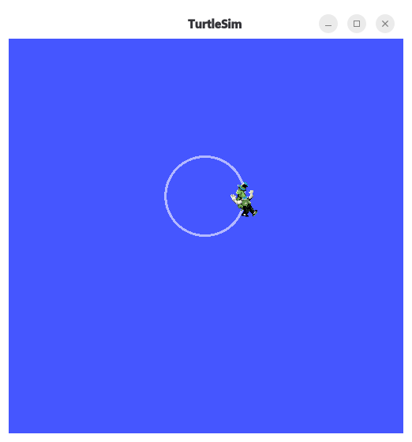

# Turtlesim Demo

This is an example for controlling turtlesim with a custom publisher node.

## Requirements

Ensure you have the following installed:

- `rclcpp` and `std_msgs`
- `geometry_msgs`
- `ros-lyrical-turtlesim`: This is not included in the devcontainer currently and can be installed with `sudo apt install ros-lyrical-turtlesim`.

## Testing Turtlesim

First ensure that the `ros2` command works. If not, source the setup file:

```sh
source /opt/ros/lyrical/setup.bash
```

Once you have turtlesim installed (see above), you can run the UI along with a builtin keyboard input node. Start the simulation node in your first terminal, this should open up the turtlesim window:

```sh
ros2 run turtlesim turtlesim_node

# output
[INFO] [1792874521.546133611] [turtlesim]: Starting turtlesim with node name /turtlesim
[INFO] [1792874521.553205151] [turtlesim]: Spawning turtle [turtle1] at x=[5.544445], y=[5.544445], theta=[0.000000]
```

Open another terminal, source the setup if necessary, and run the keyboard node:

```sh
ros2 run turtlesim turtle_teleop_key

# output
Reading from keyboard
---------------------------
Use arrow keys to move the turtle.
Use g|b|v|c|d|e|r|t keys to rotate to absolute orientations. 'f' to cancel a rotation.
'q' to quit.
```

## Running a controller

Now that turtlesim is working, you can build cpp code to control it! You can keep the turtlesim node running and stop the keyboard input one.

First, build the package. This will build `circle.cpp` (~10sec) which currently moves the turtle in a circle.

```sh
source /opt/ros/lyrical/setup.bash  # for new terminals
colcon build
```

Finally to run it:
```sh
. install/setup.bash  # adds the package

ros2 run turtlesim-demo circle  # 'turtlesim-demo' and 'circle' names are defined in CMakeLists.txt and package.xml 
```

If it succeeds, you should see the turtle begin driving in a circle:

